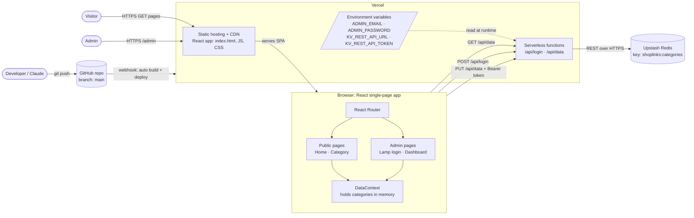
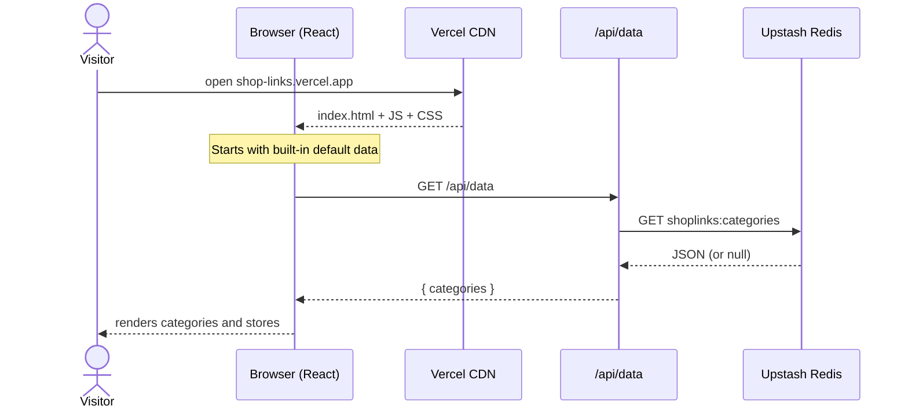
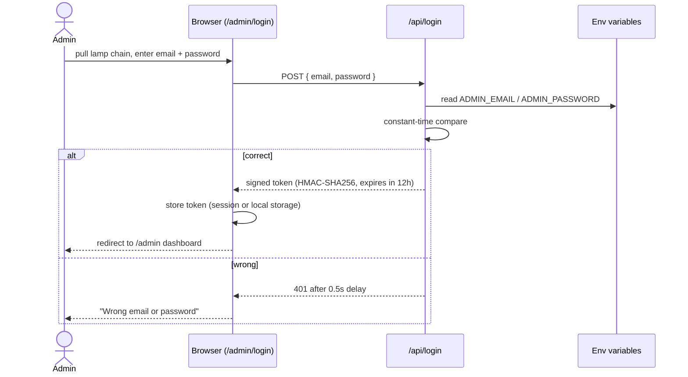
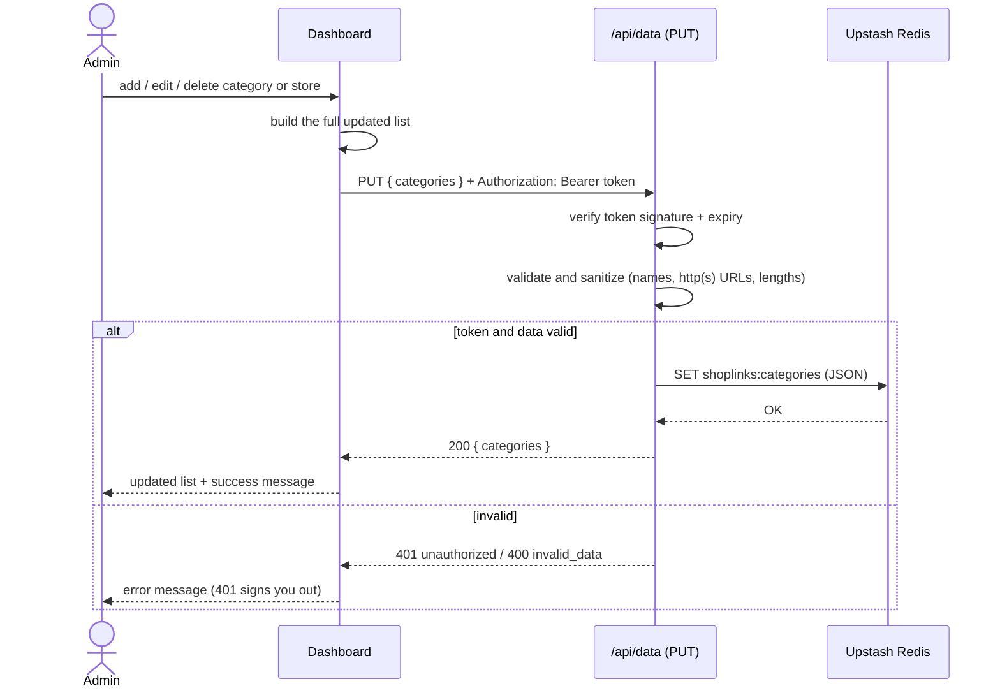
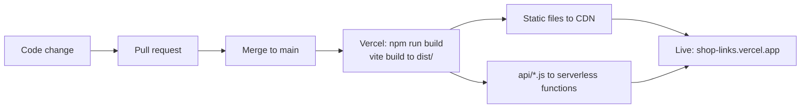

# Shop Links – Architecture

## 1. Big picture



| Part | Role | Where it runs |
|---|---|---|
| React SPA (`src/`) | UI for visitors and admin | User's browser, files served by Vercel CDN |
| Serverless API (`api/`) | Login, read and save data, validation | Vercel Functions (Node) |
| Upstash Redis | Stores all categories and stores as one JSON value | Upstash cloud |
| Env variables | Admin credentials, DB access | Vercel project settings |
| GitHub | Source of truth; push to `main` triggers deploy | github.com |

## 2. Visitor flow (public, read-only)



If the API fails or no data has been saved yet, the app keeps showing the default data bundled in `src/data/categories.js`.

## 3. Admin login flow



## 4. Admin save flow (create / edit / delete)



## 5. Deployment pipeline



`vercel.json` rewrites every non-`/api` path to `index.html`, so React Router handles `/admin`, `/admin/login`, and `/category/:slug`.

## 6. Code map

```
api/
  _lib.js        Redis access, token sign/verify, input validation
  login.js       POST: check credentials, return token
  data.js        GET: public read · PUT: admin-only save
src/
  App.jsx        Routes: /, /category/:slug, /admin/*
  lib/api.js     fetch helpers + token storage
  lib/DataContext.jsx   loads categories once, shares them
  pages/         Home, CategoryPage
  components/    CategoryCard, StoreCard, SearchBar
  admin/         AdminPage (dashboard CRUD), LampLogin (+ lamp.css, lampMarkup.js)
vite.config.js   dev-only middleware so /api works under `npm run dev`
```

## 7. Security model

- Credentials live only in Vercel env vars; the browser never receives them.
- Every write needs a valid signed token; the server re-validates all data.
- Public visitors can only read.
- Known gaps: no lockout after repeated wrong passwords, a single admin account, no automatic database backups (free Upstash plan).
